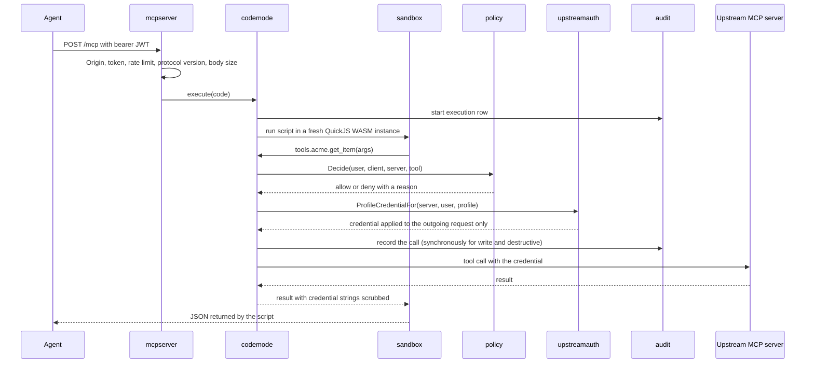
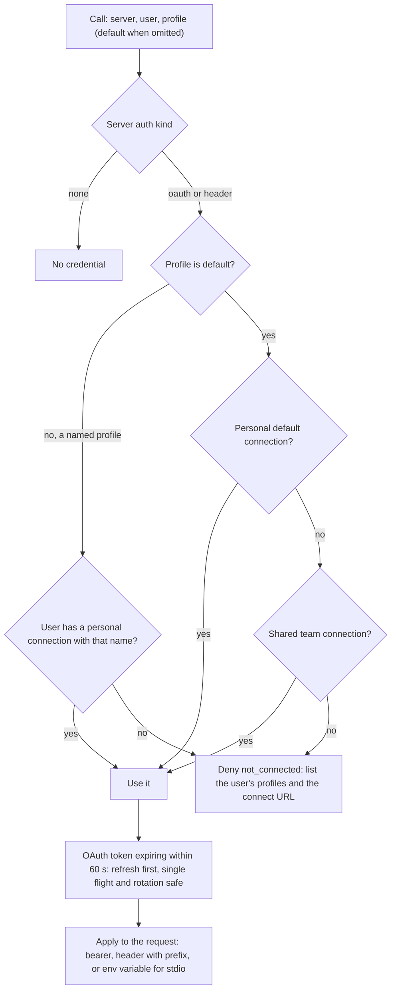
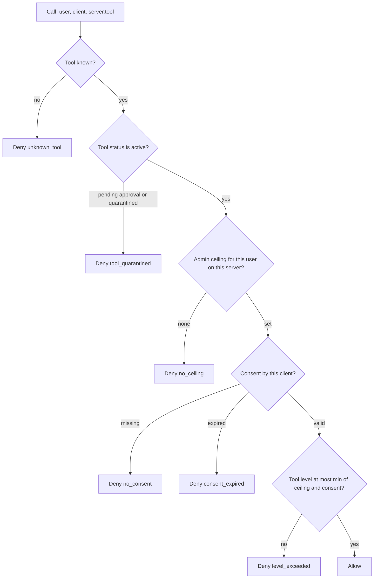
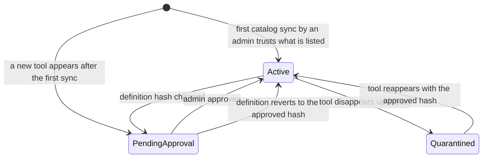

# mcpgw architecture

mcpgw puts one MCP address in front of many MCP servers. It could have been a plain
reverse proxy. It is not, because a proxy would pass every tool schema to the model, share one
credential across everyone, and trust whatever the upstream says today. This document explains
the ideas that make mcpgw more than a proxy, how each one works, and where it lives in the code
so you can find it.

Paths are relative to this file. The design specs behind some of these decisions are in
[`specs/`](specs/).

## Request flow

An agent talks to `/mcp` and sees two tools, `search` and `execute`. Everything else happens
behind them.



Every inner call from the script goes through the same pipeline, in the same order: policy,
credential, audit, upstream. The sandbox cannot skip a step because it has no other way out.

Code: [`../internal/mcpserver/handler.go`](../internal/mcpserver/handler.go),
[`../internal/codemode/execute.go`](../internal/codemode/execute.go) (the `bridge` method is the
pipeline), wiring in [`../cmd/mcpgw/gateway.go`](../cmd/mcpgw/gateway.go).

## One endpoint for every agent

Every agent, whatever the vendor, is configured with the same URL: `<MCPGW_PUBLIC_URL>/mcp`.
Adding the fortieth upstream server changes nothing on the client side.

- The edge is stateless Streamable HTTP and accepts exactly one protocol version, `2026-07-28`.
  Any other `Mcp-Protocol-Version` gets a 400 that names the supported one.
- The edge checks, in order: `Origin` (DNS rebinding protection), bearer token, per-user rate limit
  (default 10 requests per second, burst 20), protocol version, body size (1 MiB) and JSON-RPC
  batches (rejected).
- The MCP server object is built per request for the calling user. Its `execute` description lists
  only the server namespaces that user can reach. Cacheable responses are marked `private`, and
  `tools/list` gets a 5 second TTL so a consent change shows up quickly.
- Toward the upstreams the gateway is an MCP client that speaks Streamable HTTP (stateless and
  stateful eras), legacy SSE and stdio. For an `auto` server it probes once and remembers the
  result in `upstream_servers.detected_transport` and `detected_protocol_version`.
- Only tools are proxied. Upstream resources and prompts are not exposed.

Code: [`../internal/mcpserver/`](../internal/mcpserver/),
[`../internal/upstream/dial.go`](../internal/upstream/dial.go),
[`../internal/upstream/endpoint.go`](../internal/upstream/endpoint.go).

## Code mode instead of tool schemas

The usual way to give an agent many MCP servers is to load every tool schema into its context.
That costs context on every turn and grows with every server you add. mcpgw exposes two tools
instead:

- `search(query)` takes a few keywords and returns TypeScript declarations (`.d.ts`) for the best
  10 tools the caller is allowed to use, plus their qualified names.
- `execute(code)` takes an async arrow function. The agent writes JavaScript that calls
  `tools.<server>.<tool>(args)` and returns only the data it needs.

```js
async () => {
  const [issues, me] = await Promise.all([
    tools.acme.list_issues({ state: "open" }),
    tools.globex.get_me({}),
  ]);
  return { open: issues.length, user: me.login };
}
```

Because the logic runs next to the tools, the agent can chain calls, filter and join results, and
run independent reads in parallel without a round trip through the model for each step.

Details that matter when changing this code:

- Search filters by policy before it ranks, so tools the caller cannot use never influence or
  appear in a result. Ranking is a plain keyword score over name, name words, server and
  description ([`catalog/search.go`](../internal/catalog/search.go)).
- Declarations are generated from the stored schemas. Descriptions are untrusted, so they are
  collapsed to one line, truncated and have `*/` escaped. Schemas that cannot be expressed (remote
  `$ref`, cycles, depth, size) degrade to `unknown`
  ([`catalog/typescript.go`](../internal/catalog/typescript.go)).
- Tool names are exposed as identifiers (`get-item` becomes `get_item`). A script may use either
  spelling, and an ambiguous name is refused rather than guessed.
- Limits per execution: 30 s wall clock, 50 bridge calls, 8 in flight, 256 KiB result, and 3
  concurrent executions per user.
- Policy is re-checked on every inner call. The catalog cache (30 s TTL) only decides which types
  the model is shown.

Code: [`../internal/codemode/`](../internal/codemode/),
[`../internal/catalog/`](../internal/catalog/),
[`../internal/mcpserver/tools.go`](../internal/mcpserver/tools.go).

## The JavaScript sandbox

Model-written code is untrusted. It runs in QuickJS compiled to WebAssembly and executed by
wazero, so there is no cgo and no host process to escape into. The only capability the script has
is `tools.call(name, args)`, which goes back to a Go function.

What was needed to make that real, each item proven necessary in practice:

- A fresh QuickJS instance for every run. Never reused, never pooled.
- A memory ceiling that actually works. The shipped `qjs.wasm` declares no maximum memory, so the
  gateway patches the module's memory section to declare one
  ([`wasmpatch.go`](../internal/sandbox/wasmpatch.go)). Only then does wazero refuse growth and
  QuickJS raise an out-of-memory error instead of the process growing to 4 GiB.
- One goroutine owns each instance. Resolving promises from other goroutines, as the upstream qjs
  README suggests, corrupts the heap. Bridge calls run on their own goroutines and hand results
  back through a channel.
- Ambient globals are deleted (`std`, `os`, `bjson`, timers). `eval` and the `Function`
  constructors are disabled. Any source containing the token `import` is refused, strings and
  comments included, because a missed one would reach the engine's built-in modules
  ([`prelude.js`](../internal/sandbox/prelude.js)).
- The WASI root is an empty read-only directory, with no environment, arguments or sockets.
- A bounded number of scripts run at once (twice `GOMAXPROCS`); the next one waits briefly and
  then fails with a retryable busy error.
- `third_party/qjs` is a local copy of `github.com/fastschema/qjs` v0.0.6 wired in with a `replace`
  directive in `go.mod`. It carries one patch (search for `mcpgw patch` in `runtime.go`): `New`
  no longer hashes the 1 MB wasm under a global mutex on every call. A further workaround in
  [`wazerorelease.go`](../internal/sandbox/wazerorelease.go) closes a wazero runtime that qjs
  leaks per execution.

Tokens never enter the sandbox. Credentials are applied to the outgoing HTTP request only, and any
string that looks like one is scrubbed from upstream results and error messages before the script
sees them.

Code: [`../internal/sandbox/`](../internal/sandbox/), [`../third_party/qjs/`](../third_party/qjs/),
[`../internal/codemode/secrets.go`](../internal/codemode/secrets.go).

## Credential resolution

Each upstream server declares what it accepts: nothing, OAuth, or a header token. A user can hold
a personal connection, and an admin can set a shared team connection. On every call the gateway
picks the one to use, in this order: the user's personal key if they have one, otherwise the
team's shared key.



- The lookup is one query ordered so a personal row sorts before the shared one
  (`resolveCredential` in [`store.go`](../internal/upstreamauth/store.go)).
- A named profile never falls back to the shared connection. Only the default profile does.
- Shared connections are an admin act and are attributed to the admin who created them. A user
  can create, replace and remove only their own connections.
- A user who has not connected gets an error written for the model, with the exact URL to open, so
  the agent can tell the human what to do.
- An OAuth server can also accept a pasted token in an alternative header. Each connection records
  which method it uses.

Code: [`../internal/upstreamauth/tokens.go`](../internal/upstreamauth/tokens.go) (`ProfileCredentialFor`),
[`../internal/upstreamauth/store.go`](../internal/upstreamauth/store.go),
migrations [`0007`](../migrations/0007_user_credentials.sql) and
[`0013`](../migrations/0013_credential_method.sql).

## Connection profiles

One person often has several accounts on the same upstream, for example one Cloudflare account per
client. Without profiles that means one server entry per account, with a separate catalog, review
and ceiling each. mcpgw instead lets a user hold several named personal connections to one server
and lets the agent choose per call.

- For servers that use credentials, the gateway adds an optional `profile` argument to every tool
  declaration. If the upstream tool already has a `profile` property, `mcpgw_profile` is used so
  nothing is shadowed.
- Before policy, audit and the upstream see the call, the argument is removed
  (`takeProfile` in [`execute.go`](../internal/codemode/execute.go)). The upstream never knows it
  existed, and it is not part of the tool hash, so adding profiles never re-quarantines a tool.
- Upstream sessions are pooled by credential, so each profile gets its own session or process.
- The audit event records which profile was used.
- Profile names match `^[a-z][a-z0-9_-]{0,31}$`.

Code: [`../internal/catalog/catalog.go`](../internal/catalog/catalog.go) (`ProfileArg`),
migration [`0008`](../migrations/0008_connection_profiles.sql), design in
[`specs/2026-10-31-connection-profiles-design.md`](specs/2026-10-31-connection-profiles-design.md).

## Credentials at rest

Everything secret in Postgres is sealed with AES-256-GCM. The only key material outside the
database is `MCPGW_MASTER_KEY`.

- A data key is derived from the master key with HKDF-SHA256, using the key id as context. No
  wrapped keys are stored and no KMS round trip is needed. The trade-off is documented in
  [`vault.go`](../internal/vault/vault.go): the master key and the data key share a blast radius.
- Every ciphertext is bound to the row it lives in through AAD, for example
  `upstream_credentials:<server_id>:<user_id>`. The version byte, key id and nonce are authenticated
  too. A ciphertext copied into another row fails to open.
- The key id travels inside each ciphertext, so a rotation can run old and new keys side by side.
  No rotation command ships yet: `vaultKeyID` is fixed to `k1` in `cmd/mcpgw/gateway.go`.
- Sealed values include upstream access and refresh tokens, PKCE verifiers, stdio environments,
  OAuth client secrets, the private half of the JWT signing key, and the browser session and CSRF
  cookies.
- Header tokens are shown in the UI only as the last 4 characters.
- User passwords are hashed with argon2id, with a bounded number of concurrent hashes so a login
  flood cannot exhaust memory.

Code: [`../internal/vault/vault.go`](../internal/vault/vault.go), AAD builders in
[`../internal/upstreamauth/store.go`](../internal/upstreamauth/store.go),
[`../internal/oauth/password.go`](../internal/oauth/password.go).

## OAuth in both directions

The gateway is an OAuth authorization server for MCP clients, and an OAuth client of upstream
servers on each user's behalf. The token an agent holds is never forwarded upstream.

Inbound, for agents ([`../internal/oauth/`](../internal/oauth/)):

- OAuth 2.1 authorization code with PKCE S256, public clients only, one scope (`mcp`).
- Clients identify themselves with Client ID Metadata Documents (the `client_id` is an https URL
  the gateway fetches, through an SSRF guard, and caches) or with Dynamic Client Registration as a
  fallback.
- Access tokens are ES256 JWTs (`at+jwt`) valid for 10 minutes, bound to the audience
  `<public url>/mcp`. The signing key is created on first start and sealed in `signing_keys`.
- Refresh tokens rotate. Replaying a used refresh token or authorization code revokes the whole
  grant family, including live access tokens (`oauth_revoked_families`, with a 5 second positive
  cache for grants).
- Discovery documents follow RFC 8414 and RFC 9728.
- The login page and consent page are served by the gateway. The consent page is where the user
  picks an access level per server, up to their ceiling.

Outbound, for upstream servers ([`../internal/upstreamauth/`](../internal/upstreamauth/)):

- Discovery of the protected resource and authorization server, then authorization code with PKCE
  S256 and the RFC 8707 resource indicator, started at `/connect/{slug}`.
- Client registration prefers an admin-provided client, then the gateway's own metadata document at
  `/oauth/client-metadata.json` (only when the authorization server supports it and the public URL
  is https), then Dynamic Client Registration.
- Every request to an authorization server, and every fetch of client metadata, goes through a
  dialer that rejects non-public addresses at connect time, redirects included, so DNS rebinding
  does not help an attacker. Proxies are disabled for the same reason. Calls to the configured MCP
  servers themselves are pinned to the server's origin instead, since admins may legitimately point
  at private addresses.

## Policy ceilings and consent

A call is allowed only if the tool is active and its trust level is within both limits: what the
admin allows the user on that server (the ceiling), and what the user granted that specific agent
(the consent). Admins get no implicit bypass.



- Levels are ordered `read`, `write`, `destructive`. Each tool gets one by a name heuristic: a
  destructive verb anywhere wins, then a write verb, and only a name starting with a read verb is
  `read`. A bare `query` or `fetch` counts as `write` because it runs arbitrary upstream operations.
  An admin can override a level by hand and the override survives re-syncs.
- Upstream annotations are untrusted hints. They can raise a level, and can lower it to `read`
  only for servers whose annotations the admin chose to trust.
- Consent is per user, per client and per server, and expires after 90 days.
- Decisions come from an in-memory cache that [hot reload](#hot-reload-with-listen-and-notify)
  keeps fresh. While the notification connection is down, the engine skips the cache and reads
  Postgres on every decision. If Postgres is unreachable it denies with `policy_error`.

Code: [`../internal/policy/`](../internal/policy/) (`decide` in `engine.go`),
[`../internal/catalog/classify.go`](../internal/catalog/classify.go),
[`../internal/oauth/consent.go`](../internal/oauth/consent.go).

## Catalog trust

An upstream can change its tool definitions after you approved them: a new description with hidden
instructions, a widened schema, a renamed argument. mcpgw pins every tool to a hash and holds back
anything that changed until an admin reviews it.



- The hash is SHA-256 over the canonical JSON of name, description, input schema, output schema and
  annotations ([`SchemaHash`](../internal/catalog/sync.go)).
- A tool that is pending or quarantined is hidden from `search` and denied in `execute`. The model
  never sees the new definition, and it does not see the old one either, because the upstream now
  behaves as the new one says.
- `mcpgw admin tool show` prints the current definition and hash. `tool approve --hash` binds the
  approval to the definition the admin reviewed, checked in the same SQL statement as the update,
  so a concurrent sync cannot slip a different definition in.
- Only an admin's `catalog sync` sets the first trusted baseline. The periodic background sync (every
  15 minutes) skips servers with no baseline yet. Syncs made with a plain user's credential after
  they connect an account are insert-only: they can add pending tools but never trust, rewrite or
  reclassify anything.
- A server can opt in to `auto_approve_new_tools` for tools that appear after the first sync.
  Changed definitions still need review.

Code: [`../internal/catalog/sync.go`](../internal/catalog/sync.go),
[`../internal/catalog/trust.go`](../internal/catalog/trust.go),
[`../internal/catalog/autosync.go`](../internal/catalog/autosync.go), migration
[`0005`](../migrations/0005_catalog_trust.sql).

## Audit

The gateway records what it did, in a form that survives deleting users, clients and servers (the
audit tables have no foreign keys).

- Each `search` or `execute` writes one `executions` row with the full code, which is the main
  forensic evidence, and its hash and final status.
- Each inner call writes one `audit_events` row: decision, reason, latency, result size, the
  profile, a hash of the canonical arguments and a redacted, truncated view of them. Raw arguments
  are never stored. Keys that look like credentials are masked, and token shapes in values are
  masked too. Denied calls are recorded as well.
- Write and destructive calls are recorded synchronously before they are forwarded. If that write
  fails, the call is not forwarded. Reads go through a bounded buffer flushed in batches, and a
  full buffer degrades to a synchronous write instead of dropping events.
- `audit_events` is partitioned by month, and a daily job creates partitions ahead of time.
- Administrative actions from the CLI and the web UI are recorded separately in `admin_events`,
  and never include secret values.

Code: [`../internal/audit/`](../internal/audit/), migrations
[`0001`](../migrations/0001_init.sql) and [`0006`](../migrations/0006_admin.sql).

## Stdio upstreams

Many useful MCP servers only speak stdio. Running someone else's process next to your secrets is
risky, so mcpgw launches them in a throwaway container by default.

- The default launcher is `docker run --rm -i --init` with a read-only filesystem, all capabilities
  dropped, `no-new-privileges`, 512 MB of memory and swap, 256 processes, user `65534`, a
  `noexec` tmpfs and `--network none` unless the admin enabled the network.
- The server's environment is exactly what the admin configured. Nothing is inherited from the
  gateway, and values are passed to docker by name (`--env NAME`), so they never appear in the
  process list. The docker CLI itself receives only a short allowlist of variables.
- The host launcher runs an arbitrary executable on the gateway machine. It exists, but only the
  CLI can create such a server (`--host-process`). The web admin refuses it
  (`AllowHostLauncher` in [`admin/service.go`](../internal/admin/service.go)).
- Per-user credentials reach the process as an environment variable, and a server can also declare
  per-connection variables that each user fills in on the portal. Upstream sessions are pooled by
  endpoint, owner and credential fingerprint, so each user and profile gets its own process. A
  stateful upstream never mixes two users' state.
- Output lines from the process are length-bounded, and every upstream exchange has a response
  size cap (4 MiB by default). Shutdown closes stdin, then escalates to SIGTERM and SIGKILL on the
  process group and force-removes the container.
- Editing a stdio server's environment elsewhere closes its pooled processes, so the next call
  starts from the new configuration (see hot reload below).

The images in [`../docker/`](../docker/) wrap two stdio MCP servers (a Postgres one and a Redis one)
so that each mcpgw connection can choose its access mode or database. They are examples of
upstream servers, not images of the gateway.

Code: [`../internal/upstream/stdio.go`](../internal/upstream/stdio.go),
[`../internal/upstream/pool.go`](../internal/upstream/pool.go),
[`../internal/upstream/dbresolver.go`](../internal/upstream/dbresolver.go).

## Hot reload with LISTEN and NOTIFY

Policy decisions, the tool catalog and pooled stdio processes are cached in memory, yet a change
made from the CLI, the web UI or plain SQL must take effect without a restart. Postgres tells every
running gateway.

- A single channel, `policy_changed`, carries a small JSON payload (`table`, `op`, `user_id`,
  `server_id`).
- Triggers fire on `trust_ceilings`, `consents`, `tools` (only the policy-relevant columns:
  `trust_level`, `trust_level_overridden`, `status`) and `upstream_servers` (insert, delete, and
  updates to `status`, `slug`, `stdio_env_ciphertext`, `credential_env`, `auth_kind`,
  `connection_url`). The `upstream_servers` trigger was widened by migrations `0011`, `0012` and
  `0014`.
- Each gateway holds one dedicated LISTEN connection. It reconnects with exponential backoff,
  pings after 5 seconds of silence, and uses TCP keepalive, so a half-open connection is noticed
  quickly. Caches are flushed on every connect.
- A notification invalidates only what it names (one user's policy, or the tool set). One it cannot
  parse flushes everything.
- Hooks fan the event out: the codemode catalog cache is invalidated, and the pooled stdio
  processes of a changed server are closed.

Not everything uses NOTIFY. Credentials are read from Postgres on every call. OAuth grant
revocation is checked against `oauth_revoked_families` with a 5 second cache.

Code: [`../internal/policy/listen.go`](../internal/policy/listen.go),
[`../internal/policy/cache.go`](../internal/policy/cache.go), migrations
[`0001`](../migrations/0001_init.sql), [`0002`](../migrations/0002_upstream_servers_notify.sql),
[`0011`](../migrations/0011_stdio_env_notify.sql), [`0012`](../migrations/0012_credential_env_notify.sql),
[`0014`](../migrations/0014_connection_url.sql).

## Embedded UI and its CSP

The admin and portal web app is a Next.js static export (`output: 'export'`) compiled into
`web/admin/out` and embedded in the Go binary with `go:embed`. There is no Node process at runtime,
no second deployment and no CORS: the UI and its JSON APIs (`/admin/api`, `/portal/api`) share one
origin.

Because the export is static, the Content-Security-Policy can be strict without nonces. At startup
the handler reads every exported HTML page, computes the SHA-256 of every inline `<script>` and
`<style>`, and builds a policy that allows exactly those hashes: no `unsafe-inline`, `default-src
'self'`, `frame-ancestors 'none'`, `base-uri 'none'`.

- Only `/admin/`, `/portal/`, `/_next/` and a fixed list of brand assets are served. Traversal,
  empty and dot segments are rejected.
- A fresh clone has only `web/admin/out/.keep`. The handler then answers 503 with a placeholder
  page instead of failing to build.
- Admin sessions live entirely in a sealed `mcpgw_admin` cookie (30 minute idle limit, 8 hour
  absolute limit) with a CSRF token. Writes must carry the gateway's own `Origin`. Writes that store
  secrets ask for the password again within a 5 minute window. With an https public URL the cookies
  become `Secure` with the `__Host-` prefix.
- The admin API and the CLI share one core, `internal/admin`, so no operation is implemented twice.
  The portal shares the OAuth login session, so a user has one login, not two.

Code: [`../internal/adminapi/static.go`](../internal/adminapi/static.go),
[`../web/admin/embed.go`](../web/admin/embed.go),
[`../internal/adminapi/session.go`](../internal/adminapi/session.go), design in
[`specs/2026-10-29-admin-web-design.md`](specs/2026-10-29-admin-web-design.md).

## Limits worth knowing

- State held in memory is per process: rate limiters, the grant cache, sandbox slots and the
  upstream session pool. Postgres is the only shared state.
- Rate limits and audit IPs use the connection's remote address. `X-Forwarded-For` is not trusted,
  so behind a reverse proxy the per-IP limits see the proxy.
- The gateway serves plain HTTP. TLS terminates in front of it.
- The sandbox's read-only WASI root does not protect a process running as root. Run the gateway as
  an unprivileged user.
- No key rotation command exists yet, although the ciphertext format supports it.
- User-facing text is localized in English and Brazilian Portuguese through `internal/i18n` (Go:
  `Accept-Language` for HTTP, `LANG` for the CLI) and `web/admin/lib/i18n` (typed catalogs). Text
  read by agents is English only. The code, comments and identifiers are in English.

## Package map

| Path | What it does |
| --- | --- |
| `cmd/mcpgw` | The binary: `serve`, `migrate` and `admin`. `gateway.go` wires every component, `jobs.go` runs periodic maintenance, `dotenv.go` loads `.env`. |
| `cmd/loadgen` | Developer load generator that drives concurrent `execute` calls and reports latency and RSS, with a fake upstream. |
| `internal/admin` | Administration core shared by the CLI and `/admin/api`: typed inputs, validation and SQL. |
| `internal/adminapi` | `/admin/api` handlers, sealed-cookie admin sessions and the static handler with the hash-based CSP. |
| `internal/apijson` | JSON error envelope, body decoding and pagination cursors shared by the admin and portal APIs. |
| `internal/audit` | `executions` and `audit_events` recorder with redaction, batching and monthly partitions. |
| `internal/i18n` | Locale negotiation (`Accept-Language`, `LANG`) and bilingual `Text` (en + pt-BR) for API errors, OAuth pages and the CLI. |
| `internal/catalog` | Tool trust classification, namespacing, TypeScript declarations, search and the sync that pins definitions. |
| `internal/codemode` | The `search` and `execute` service and the per-call pipeline: policy, credential, audit, upstream. |
| `internal/config` | Reads and validates configuration from environment variables. |
| `internal/deps` | Placeholder that pins a dependency with a blank import. Now redundant and a candidate for removal. |
| `internal/mcpserver` | The `/mcp` edge: authentication, rate limits, protocol checks and the two tools. |
| `internal/oauth` | OAuth 2.1 authorization server for MCP clients, login and consent pages, JWT keys and sessions. |
| `internal/policy` | Policy decision point: ceilings, consents, tool status and the LISTEN loop that keeps caches fresh. |
| `internal/portalapi` | `/portal/api`: each signed-in user's own connections, profiles and tokens. |
| `internal/sandbox` | QuickJS on wazero executor that runs untrusted scripts with a single `tools.call` bridge. |
| `internal/store` | Postgres pool, the embedded-migration runner, and `storetest` for throwaway test databases. |
| `internal/upstream` | MCP client toward upstreams: transports, auto-detection, session pool, stdio launchers. |
| `internal/upstreamauth` | The gateway as OAuth client of upstreams, credential storage and per-call credential resolution. |
| `internal/vault` | AES-256-GCM sealing with HKDF-derived keys and AAD. |
| `migrations/` | Numbered SQL files (`0001` to `0014`) embedded in the binary and applied in order, one transaction each. |
| `web/admin` | Next.js admin and portal app, its tests and end to end suite, brand assets, and `embed.go`. |
| `third_party/qjs` | Vendored `fastschema/qjs` with one patch, bundling the QuickJS-ng wasm. MIT, see `NOTICE`. |
| `docker/` | Wrapper images for two stdio MCP servers that mcpgw can launch (Postgres and Redis). |
| `docs/specs/` | Design specs for the admin web UI and for connection profiles. |
